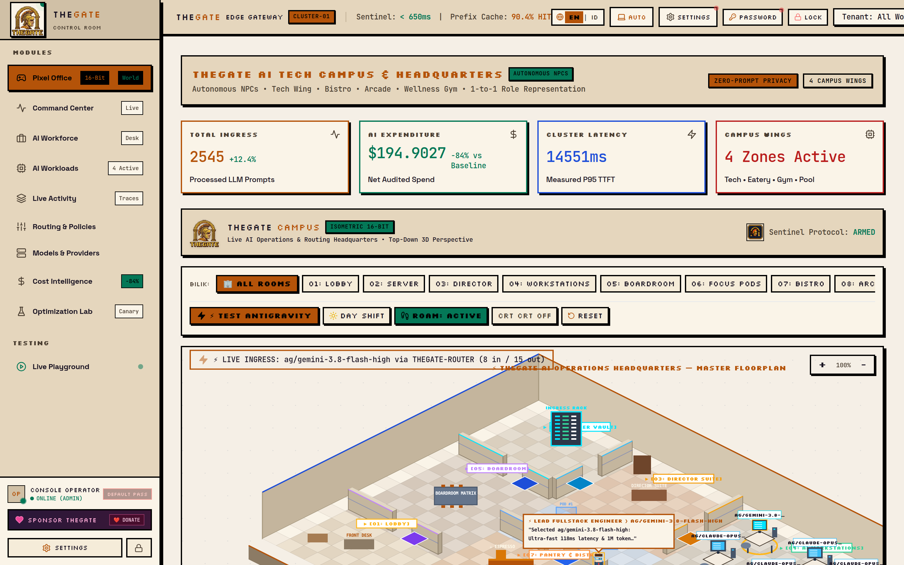
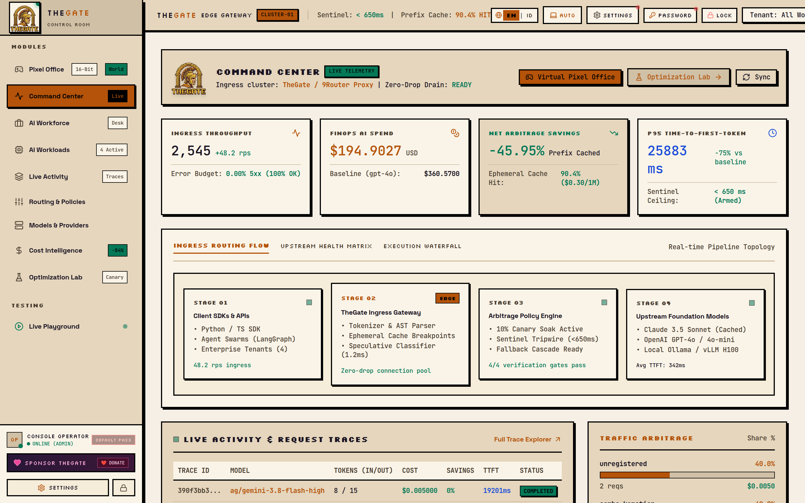
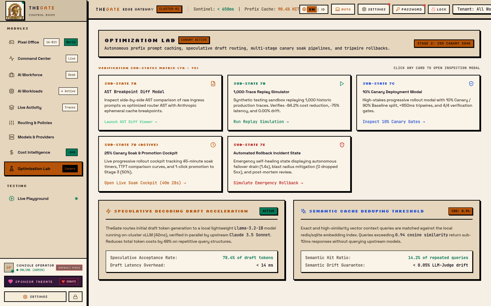
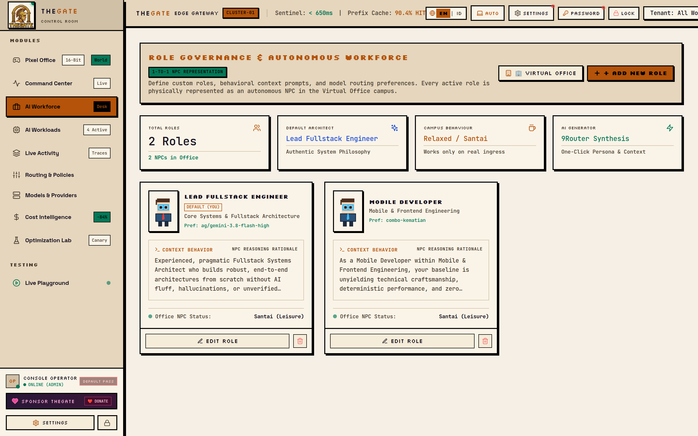
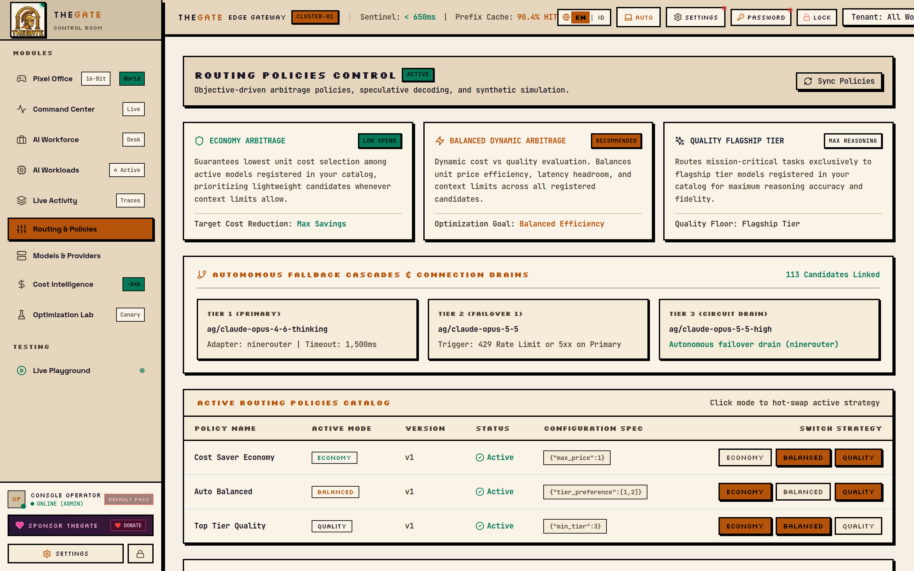

<div align="center">

# ⛩️ TheGate

**The Control Plane for AI: Intelligent LLM Routing & Operations Cockpit**

[](https://www.npmjs.com/package/thegate)
[](LICENSE)
[](https://nodejs.org/)
[](https://fastify.dev/)
[](https://nextjs.org/)
[]()

*Optimize every LLM request, minimize provider costs, and monitor your AI workforce in a retro cyberpunk virtual operations room.*

<p align="center">
  <a href="#-quickstart">Quickstart</a> •
  <a href="#-interface--mockups">Screenshots</a> •
  <a href="#-key-features">Features</a> •
  <a href="#-architecture">Architecture</a> •
  <a href="#-sdk-integration">SDK Integration</a> •
  <a href="#-cli-commands">CLI Reference</a>
</p>

---

</div>

## 💡 What is TheGate?

**TheGate** is an open-source, self-hosted intelligent LLM routing and cost-optimization gateway. It sits between your AI applications and downstream model providers (such as 9Router, OpenAI, Anthropic, or local Ollama instances).

Exposing a **100% OpenAI-compatible Chat Completions API** (`POST /v1/chat/completions`), TheGate analyzes incoming requests in real-time and routes prompts to the most cost-effective eligible model that satisfies your technical constraints—all without ever storing your prompt or completion text.

---

## 📸 Interface & Mockups

<div align="center">

### 🕹️ 1. Virtual 2D Pixel-Art Office Simulation
*Watch autonomous AI agents collaborate in real-time, animate tasks at their desks, and solve recommendation quests.*



<br/><br/>

### 📊 2. Real-Time Operations Cockpit & Gateway Overview
*Live LLM traffic throughput, token consumption, routing decisions, and health telemetry.*



<br/><br/>

### 💰 3. FinOps & Baseline Cost Savings Engine
*Measure actual dollar savings against benchmark models (GPT-4o / Claude 3.5 Sonnet) with verifiable accounting.*



<br/><br/>

### 👥 4. AI Workforce & Autonomous Agent Management
*Assign specialized AI roles, configure model capabilities, and balance organizational workloads.*



<br/><br/>

### 🎯 5. Dynamic Routing Policies & Guardrails
*Configure Economy, Balanced, and Quality rules with strict context limits, tool-calling filters, and fallback chains.*



</div>

---

## 🚀 Key Features

### 1. ⚡ Instant Zero-Config CLI
Launch TheGate with a single command from your terminal via npm. No manual cloning or complicated multi-step configuration needed:
```bash
npx thegate
```

### 2. 🎯 Smart Routing Engine (`Economy` | `Balanced` | `Quality`)
* **`Economy`**: Aggressively minimizes cost by picking the lowest-cost model meeting hard technical requirements (context window limit, tool/function calling support).
* **`Balanced`**: Balances cost savings against benchmark scores and historical latency.
* **`Quality`**: Prioritizes top-tier reasoning and accuracy while adhering to policy guardrails.
* **Resilient Fallback Chains**: Seamless failover to fallback models if the primary provider times out or fails—with strictly **no fallbacks once streaming output has started** to prevent corrupted client streams.

### 3. 💰 Transparent FinOps & Baseline Cost Comparison
* Auditable cost metrics distinguishing `PROVIDER_REPORTED`, `ESTIMATED`, and `UNKNOWN` pricing.
* **Baseline Measurement**: Compare actual spend against an explicit baseline model (e.g., GPT-4o or Claude 3.5 Sonnet) to measure verified dollar savings.
* Built-in protection against double-counting retries.

### 4. 🛡️ Privacy by Default (Zero Prompt Persistence)
* **Zero Prompt / Completion Storage**: User prompts and generated text are never written to disk or database.
* **Metadata-Only Auditing**: Only token counts, latency timestamps, routing rationales, and HTTP status codes are recorded.
* **Credential Redaction**: Authorization headers and downstream API keys are never exposed in logs or error payloads.

### 5. 🕹️ Virtual Pixel Office & AI Workforce Cockpit
* A retro 2D pixel-art office simulation where AI agents and roles sit at desks, manage tasks, and animate in real-time.
* **Role & Workload Management**: Assign models to company roles (e.g., Code Reviewer, Customer Support, Data Analyst).
* **Recommendation Quests**: Interactive optimization suggestions and quests to improve routing efficiency.

### 6. 🔌 Pluggable Provider Adapters
* Provider-agnostic routing core cleanly decoupled from backends via `BaseProviderAdapter`.
* Native support for **9Router**, **OpenAI**, **Mock Adapters** (for local testing), and extensible to custom endpoints.

---

## ⚡ Quickstart

### Option A: Via npm / npx (Recommended)

Run instantly without installation:
```bash
npx thegate
```

Or install globally to use the `thegate` command anywhere:
```bash
npm install -g thegate

# Launch interactive control room:
thegate

# Start background services:
thegate start

# Inspect cluster health:
thegate status

# Open web dashboard:
thegate open
```

---

### Option B: Local Source Clone

```bash
# 1. Clone the repository
git clone https://github.com/fikalalif/thegate.git
cd thegate

# 2. Register global CLI command
npm link

# 3. Start TheGate
thegate
```

---

### Option C: Docker Compose

```bash
cp .env.example .env
docker compose up -d
```

Once running, access:
* **Unified Control Plane & Web Dashboard:** `http://localhost:4848`
* **Virtual 2D Pixel Office Simulation:** `http://localhost:4848/office`
* **Chat Completions Ingress API:** `http://localhost:4848/v1/chat/completions`

---

## 🛠️ SDK Integration (OpenAI Drop-In)

Because TheGate provides an OpenAI-compatible API, you only need to change your `base_url`:

### Python (`openai` SDK)

```python
from openai import OpenAI

client = OpenAI(
    base_url="http://localhost:4848/v1",
    api_key="thegate_dev_key"  # Or your configured TheGate API Key
)

# Standard Chat Completion
response = client.chat.completions.create(
    model="thegate/balanced",  # Or "thegate/economy", "thegate/quality"
    messages=[
        {"role": "system", "content": "You are a helpful software engineering assistant."},
        {"role": "user", "content": "Explain the advantages of database connection pooling."}
    ],
    temperature=0.7,
)

print(response.choices[0].message.content)
```

### TypeScript / Node.js

```typescript
import OpenAI from "openai";

const client = new OpenAI({
  baseURL: "http://localhost:4848/v1",
  apiKey: "thegate_dev_key",
});

async function main() {
  const completion = await client.chat.completions.create({
    model: "thegate/economy",
    messages: [{ role: "user", content: "Write a quicksort implementation in Python." }],
    stream: true,
  });

  for await (const chunk of completion) {
    process.stdout.write(chunk.choices[0]?.delta?.content || "");
  }
}

main();
```

### cURL

```bash
curl -X POST http://localhost:4848/v1/chat/completions \
  -H "Content-Type: application/json" \
  -H "Authorization: Bearer thegate_dev_key" \
  -d '{
    "model": "thegate/balanced",
    "messages": [
      {"role": "user", "content": "Hello, how does TheGate optimize costs?"}
    ]
  }'
```

---

## 🏛️ Architecture Overview

```text
                        CLIENT APPLICATION
                       (OpenAI SDK / HTTP)
                                |
                                v
                     THEGATE UNIFIED GATEWAY
                     (Fastify • Single Port 4848)
                     [Auth, Proxy, SSE Telemetry]
                                |
                                v
                        REQUEST ANALYZER
                [Token Estimation & Requirements]
                                |
                                v
                        POLICY EVALUATOR
               [Context Limits, Tools, Latency]
                                |
                                v
                         ROUTING ENGINE
            [Economy • Balanced • Quality Strategies]
                                |
                +---------------+---------------+
                |                               |
                v                               v
         Model Registry                    Cost Catalog
         (Active Models)               (Pricing & Baselines)
                |                               |
                +---------------+---------------+
                                |
                                v
                         PROVIDER ADAPTER
                      (9Router / OpenAI / Mock)
                                |
                                v
                       DOWNSTREAM PROVIDER
                                |
                                v
                        RESPONSE HANDLER
                  (SSE Streaming / Non-Streaming)
                                |
                 +--------------+--------------+
                 |                             |
                 v                             v
           Client Stream              Database Persistence
        (Immediate Passthrough)      (Zero Prompt Persistence)
                                      • Request Attempts
                                      • Routing Decisions
                                      • Cost Accounting
                                               |
                                               v
                                      NEXT.JS 14 DASHBOARD
                                       (Pixel Office & UI)
```

---

## 💻 CLI Commands

| Command | Description |
| :--- | :--- |
| `thegate` | Opens the interactive terminal control room with ASCII emblem |
| `thegate start` | Starts the gateway and frontend dashboard in background |
| `thegate stop` | Gracefully stops all active TheGate processes |
| `thegate status` | Inspects health, database, and downstream router status |
| `thegate open` | Launches the web dashboard in your default browser |
| `thegate connect` | Downstream connection wizard (9Router, Ollama, OpenAI) |
| `thegate --help` | Displays available flags and options |
| `thegate --version`| Displays installed version |

---

## 📂 Project Structure

```text
thegate/
├── bin/                       # Global CLI runner & ASCII Banner
│   ├── thegate.js             # CLI process manager (start, stop, status)
│   └── banner.js              # Retro pixel emblem banner
│
├── server/                    # Native Fastify Ingress & Routing Engine (Zero-Python)
│   ├── index.js               # Fastify HTTP Server (:8001) + CORS
│   ├── db/                    # Cross-platform SQLite layer & Seed defaults
│   ├── engine/                # Predictive Intent Classifier & Heuristic Routing
│   ├── adapters/              # 9Router Client, SSE Streaming & Resilient Fallbacks
│   └── routes/                # Completions, Models, Providers, Policies, Analytics, Roles, Keys, Auth
│
├── frontend/                  # Next.js 14 App Router Dashboard
│   ├── src/app/               # Pages (Overview, Costs, Models, Workforce, Office)
│   ├── src/components/        # Pixel art components, office simulation, charts
│   └── src/lib/               # Typed API client, authentication, i18n
│
├── docker-compose.yml         # Containerized orchestration
├── .env.example               # Environment variables template
└── README.md
```

---

## 🧪 Running Tests

Ensure all automated tests pass before deploying:

```bash
# Run Fastify backend test suite
npm test

# Run live 9Router integration test
npm run test:live

# Run frontend TypeScript validation
cd frontend && npx tsc --noEmit
```

---

## 🤝 Contributing

Contributions are welcome! Please read the guidelines in [docs/IMPLEMENTATION_PLAN.md](docs/IMPLEMENTATION_PLAN.md) and [GEMINI.md](GEMINI.md) before submitting pull requests.

1. Fork the Project
2. Create your Feature Branch (`git checkout -b feature/AmazingFeature`)
3. Commit your Changes (`git commit -m 'feat: add AmazingFeature'`)
4. Push to the Branch (`git push origin feature/AmazingFeature`)
5. Open a Pull Request

---

## 📄 License

Distributed under the MIT License. See `LICENSE` for more information.

---


<div align="center">
  <b>Built with ❤️ by TheGate Core Team</b>
</div>
