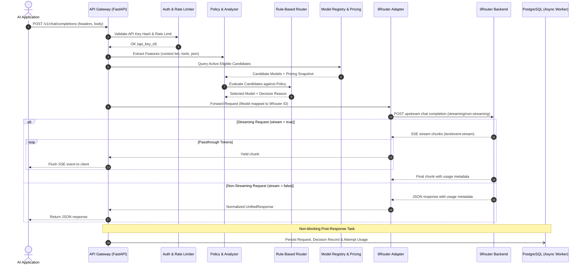
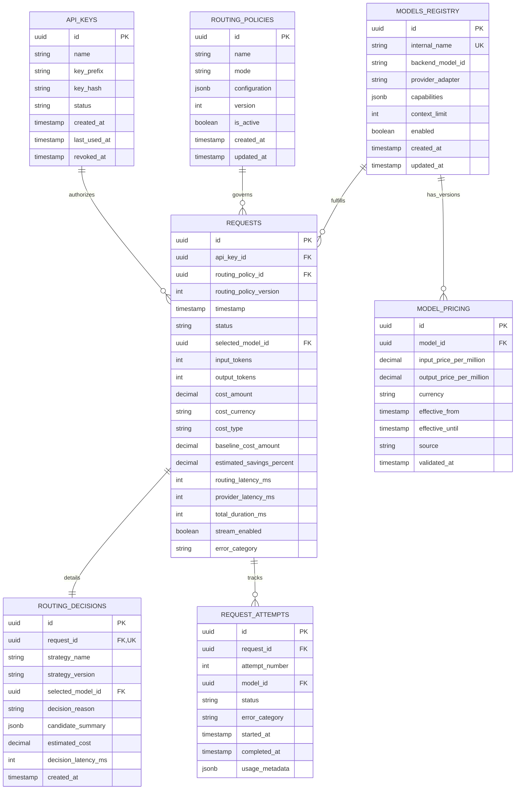

# TECHNICAL DESIGN & DISCOVERY REPORT — THEGATE

**Document Status:** Ready for Review  
**Author:** Founding Software Engineer & Architect  
**Target Release:** MVP v1.0  
**Repository Working Directory:** `/home/fikal/fikal/research`  
**Referenced Source of Truth:** `docs/PRD.md`, `docs/ARCHITECTURE_DECISIONS.md`  

---

## 1. Understanding of TheGate

### 1.1 What TheGate Is
**TheGate** is an open-source, self-hosted intelligent LLM routing and AI cost optimization platform. It functions as an architectural optimization layer positioned between downstream client applications and upstream AI infrastructure (specifically, model gateways or direct providers).

TheGate exposes a drop-in **OpenAI-compatible Chat Completions API** (`POST /v1/chat/completions`). It inspects incoming requests, analyzes technical requirements and constraints, evaluates user-defined routing policies, and directs each request to the most cost-efficient eligible model that satisfies the required quality and capability profile.

### 1.2 What TheGate Is NOT
- **Not a naive cheapest-model proxy:** Choosing the cheapest model blindly destroys application quality. TheGate balances cost, latency, capability, and evaluation benchmarks.
- **Not a generic multi-provider directory:** TheGate does not merely catalog endpoints; it actively tracks versioned token pricing, logs auditable routing rationales, computes counterfactual baselines, and attributes request attempts.
- **Not a hosted SaaS or multi-tenant billing platform for MVP:** The initial architecture is a clean, self-hosted modular monolith tailored for AI application developers and small engineering teams running on Docker Compose.
- **Not a prompt cache or prompt memory system:** TheGate does not store prompt or completion text by default (*Privacy by Default*).

### 1.3 Core Capability Pillars
1. **Intelligent Routing:** Policy-driven model selection respecting hard capability constraints (context limits, tools/JSON support) and routing objectives (`Economy`, `Balanced`, `Quality`).
2. **Cost Intelligence:** Auditable accounting distinguishing `PROVIDER_REPORTED`, `ESTIMATED`, and `UNKNOWN` costs, with versioned token catalogs and counterfactual baseline comparison.
3. **Quality-Aware Optimization Foundation:** A benchmark-driven framework to objectively validate that cost reductions do not degrade user-facing task performance.

---

## 2. Core User Problem and Proposed Solution

### 2.1 The Problem
Developers building LLM applications commonly face:
1. **Static, Overprovisioned Model Allocation:** A simple classification or greeting prompt is sent to expensive flagship models (e.g. GPT-4o, Claude 3.5 Sonnet) simply because the entire application is configured with one global model identifier.
2. **Fragmented, Inaccurate Cost Tracking:** Spend is scattered across disparate dashboards with varying pricing tiers, making unit economics per request difficult to calculate.
3. **No Measurable Baseline:** Engineering teams claim cost reductions by switching models, but cannot objectively prove savings against what the previous baseline would have cost on identical traffic.
4. **Dangerous Fallback Behavior:** Naive retries in multi-model proxies frequently retry after streaming has begun, double-count costs, or fallback to models lacking necessary capabilities (e.g., function calling).

### 2.2 The Proposed Solution
TheGate solves this by introducing:
- **Drop-in Integration:** Change the application `base_url` to `http://localhost:8000/v1` and supply an API key.
- **Policy Engine:** Declaratively define whether a request prefers low cost (`Economy`), balanced performance (`Balanced`), or maximum benchmarked accuracy (`Quality`).
- **Transparent Decision Audit:** Every request produces a `routing_decision` record documenting why a specific model was chosen, what candidates were evaluated, and the decision latency.
- **Counterfactual Baseline Engine:** Dynamically calculates what a request *would have cost* under a user-defined reference model (e.g. GPT-4o), providing undeniable, measurable savings percentages.

---

## 3. MVP Boundary (In-Scope vs. Out-of-Scope)

```
+-----------------------------------------------------------------------------------+
|                                  THEGATE MVP                                      |
+-----------------------------------------------------------------------------------+
| [IN-SCOPE]                                                                        |
|  - OpenAI-compatible API subset: POST /v1/chat/completions                        |
|  - Streaming (SSE) and Non-Streaming response delivery                            |
|  - Provider Adapter Abstraction with 9Router initial implementation               |
|  - Deterministic Rule-Based Routing Strategy (latency < 5ms)                      |
|  - Policy Engine supporting Economy, Balanced, Quality modes                      |
|  - Hard constraint filtering (context limit, tools/function calling, active status)|
|  - Model Registry & Versioned Pricing Catalog (per 1M input/output tokens)        |
|  - Cost Accounting Engine (Estimated, Provider-Reported, Unknown)                 |
|  - Counterfactual Baseline Comparison Engine                                      |
|  - Request, Decision & Attempt Logging (Metadata-Only)                            |
|  - PostgreSQL persistence with Alembic migrations                                 |
|  - API Key Authentication & Rate Limiting                                         |
|  - Minimal Analytics Dashboard (Next.js + Tailwind + Charts)                      |
|  - Docker Compose single-node deployment & Health checks                          |
|  - Automated Pytest suite with mock 9Router backend                               |
+-----------------------------------------------------------------------------------+
| [OUT-OF-SCOPE FOR MVP]                                                            |
|  - Multi-tenant enterprise organizations and role-based access control (RBAC)     |
|  - Stripe / SaaS billing integration                                              |
|  - Fine-tuning models or training custom routing models from scratch              |
|  - Prompt content / completion text storage (Privacy by Default)                  |
|  - Semantic vector caching and Redis clustering                                   |
|  - Full OpenAI API parity (embeddings, assistants, audio, images out-of-scope)    |
|  - Automatic production policy auto-mutation                                      |
+-----------------------------------------------------------------------------------+
```

---

## 4. Expected End-to-End Request Flow

### 4.1 Sequence Diagram



### 4.2 Lifecycle Phases:
1. **Ingestion & Guardrails:** Check `Authorization: Bearer <thegate_key>`, check per-key rate limit, parse Pydantic schema.
2. **Analysis & Feasibility:** Scan request parameters (does it require `tools` or `response_format`? What is the estimated input character/token length?). Filter out models with context limit smaller than input or models disabled in policy.
3. **Strategy Execution:** Select model matching the policy. In `Economy` mode, sort eligible candidates by input+output token price and pick lowest. In `Balanced` mode, select the optimal price/performance sweet spot. In `Quality` mode, pick highest tier candidate.
4. **Adapter Dispatch:** Map internal model identifier to 9Router ID. Dispatch via `httpx.AsyncClient`.
5. **Streaming/Delivery:** Passthrough data immediately. Zero buffering. If failure occurs before stream bytes flow, evaluate bounded fallback. If failure occurs after stream bytes flow, terminate immediately with error.
6. **Auditable Accounting:** Capture input/output token usage from upstream response. Lookup active pricing snapshot in `model_pricing`. Calculate `input_cost`, `output_cost`, and `baseline_cost`. Store in database asynchronously.

---

## 5. Proposed Module Architecture

```
TheGate/
├── backend/
│   ├── app/
│   │   ├── api/
│   │   │   ├── deps.py               # Dependency injection (DB, Auth, Config)
│   │   │   ├── middleware.py         # Rate limiting, Request ID, Error handlers
│   │   │   └── v1/
│   │   │       ├── completions.py    # POST /v1/chat/completions (OpenAI compatible)
│   │   │       ├── policies.py       # CRUD /api/v1/policies
│   │   │       ├── models.py         # CRUD /api/v1/models & pricing
│   │   │       ├── analytics.py      # GET /api/v1/analytics/*
│   │   │       ├── requests.py       # GET /api/v1/requests (Logs explorer)
│   │   │       └── health.py         # GET /health, GET /ready
│   │   ├── core/
│   │   │   ├── config.py             # Pydantic Settings (.env loader)
│   │   │   ├── security.py           # API Key hashing & verification
│   │   │   └── exceptions.py         # Domain error definitions & mapping
│   │   ├── engine/
│   │   │   ├── analyzer.py           # Request character/token length & feature extractor
│   │   │   ├── policy.py             # Policy evaluator & hard constraint filter
│   │   │   ├── strategy/
│   │   │   │   ├── base.py           # BaseRoutingStrategy interface
│   │   │   │   ├── rule_based.py     # Deterministic baseline router
│   │   │   │   └── routellm.py       # Evaluative RouteLLM integration (Phase 3)
│   │   │   └── accounting.py         # Token cost calculator & baseline counterfactuals
│   │   ├── adapters/
│   │   │   ├── base.py               # BaseProviderAdapter interface
│   │   │   └── ninerouter.py         # 9Router HTTP & SSE implementation
│   │   ├── db/
│   │   │   ├── session.py            # SQLAlchemy async session manager
│   │   │   ├── base.py               # Declarative base
│   │   │   └── models/               # ORM Models (api_keys, requests, models, etc.)
│   │   └── schemas/                  # Pydantic models (OpenAI specs, internal models)
│   ├── migrations/                   # Alembic migration scripts
│   ├── pyproject.toml / requirements.txt
│   └── Dockerfile
├── frontend/
│   ├── src/
│   │   ├── app/                      # Next.js App Router pages
│   │   │   ├── page.tsx              # Overview dashboard
│   │   │   ├── requests/             # Request logs explorer
│   │   │   ├── policies/             # Routing policy management
│   │   │   ├── models/               # Model registry & pricing catalog
│   │   │   └── analytics/            # Cost & latency deep-dive
│   │   ├── components/               # UI components, charts, tables
│   │   └── lib/api.ts                # Backend API client
│   ├── package.json
│   └── Dockerfile
├── docs/                             # PRD, Architecture, Technical Design, Plans
├── tests/
│   ├── unit/                         # Policy, Strategy, Accounting unit tests
│   └── integration/                  # Adapter, Gateway & Database integration tests
├── docker-compose.yml
├── .env.example
├── .gitignore
├── GEMINI.md
└── README.md
```

---

## 6. Initial Database Entities and Relationships

### 6.1 Entity Relationship Diagram (ERD)



### 6.2 Key Constraints & Types
- **Primary Keys:** UUIDv4 generated at application layer to avoid DB roundtrips.
- **Financial Numbers:** `NUMERIC(12, 6)` or `DECIMAL` for micro-dollar token costs. Never use IEEE floating-point numbers (`FLOAT`/`DOUBLE`).
- **Timestamps:** UTC `TIMESTAMPTZ` exclusively.
- **Privacy Enforcement:** No column stores prompt text or completion text in `requests` or `request_attempts`.

---

## 7. 9Router Integration Assumptions to be Verified

### 7.1 [VALIDATED FACTS]
- 9Router is an OpenAI-compatible routing and aggregation layer.
- Upstream requests use standard HTTP POST with JSON body containing `model`, `messages`, `stream`, etc.
- Standard Bearer token authentication via HTTP `Authorization: Bearer <API_KEY>`.

### 7.2 [PROPOSED DECISIONS]
- TheGate configures 9Router base URL via `NINEROUTER_BASE_URL` (e.g. `http://9router:8080/v1` or external endpoint).
- `NineRouterAdapter` encapsulates all communication using an asynchronous HTTP client (`httpx.AsyncClient`) with connection pooling and explicit timeouts (e.g., connect timeout: 5s, read timeout: 60s).
- In streaming mode, 9Router sends Server-Sent Events with lines beginning with `data: `, ending with `data: [DONE]`.

### 7.3 [UNRESOLVED QUESTIONS]
1. **Token Usage in Streams:** Does the specific deployed 9Router version automatically return a final SSE chunk with the `usage` object (like OpenAI with `stream_options: {"include_usage": true}`), or does it omit token counts on stream finish?
2. **Model Identifier Mapping:** Does 9Router require specific vendor prefixes (e.g. `openai/gpt-4o-mini`, `anthropic/claude-3-5-sonnet`) or standard unprefixed names?
3. **Upstream Rate Limit Responses:** How does 9Router structure HTTP 429 errors? Does it forward the upstream provider error body or wrap it in a custom 9Router envelope?
4. **Provider-Reported Cost:** Does 9Router calculate and return cost directly in the response metadata, or must TheGate calculate 100% of costs internally via its `model_pricing` catalog?

---

## 8. RouteLLM Compatibility Questions to be Resolved

### 8.1 [VALIDATED FACTS]
- RouteLLM is an open-source library from LMSYS designed to route requests between a high-cost "strong" model and a low-cost "weak" model using pre-trained routers (matrix factorization, BERT classifier, casual LLM).

### 8.2 [PROPOSED DECISIONS]
- **RouteLLM will NOT be a mandatory core dependency for the MVP.**
- For MVP Phase 1 & 2, TheGate will rely solely on the lightweight, deterministic `RuleBasedStrategy`.
- RouteLLM will be investigated in **Phase 3 (Quality-Aware Routing)** as an optional plugin.

### 8.3 [UNRESOLVED QUESTIONS]
1. **Dependency Footprint:** RouteLLM requires PyTorch, transformers, datasets, and huggingface-hub. This inflates the backend Docker container from ~150 MB to >2.5 GB. Is the self-hosted userbase willing to tolerate this container size?
2. **Decision Latency (NFR-001):** Can RouteLLM evaluate a prompt in under 100ms (p95) on a standard 2-core CPU without a GPU? If matrix factorization or BERT evaluation on CPU takes 150-300ms, it violates NFR-001.
3. **Multi-Model Generalization:** RouteLLM is trained primarily on pairs (e.g., GPT-4 vs Mixtral 8x7B). How easily does it generalize to a dynamic pool of 10+ models available in 9Router?

---

## 9. Security and Privacy Risks & Safeguards

| Threat Vector | Severity | Vulnerability Description | TheGate Architectural Safeguard |
| :--- | :--- | :--- | :--- |
| **API Key Compromise** | High | Leaked TheGate application keys allow unauthorized inference usage. | Keys stored hashed with SHA-256 / Argon2id; only prefix (e.g., `tg_live_3a1...`) stored plaintext for dashboard identification. |
| **Credential Leakage** | Critical | 9Router master API key or upstream provider keys leaked via client responses. | Upstream keys stored strictly in server environment variables; never exposed via API responses or frontend client bundles. |
| **Data Privacy Breach** | Critical | User prompts containing PII/proprietary code stored in database. | **Privacy by Default:** Zero persistence of prompt or completion text. Only token counts, latency, and model metadata logged. |
| **Denial of Service (DoS)** | High | Attackers sending massive payloads or flooding endpoints. | Request body size limited to 2MB; IP and API Key rate limiting middleware; client timeout bounds. |
| **SQL Injection** | Critical | Malicious input in filters/searches tampering with database queries. | Strict SQLAlchemy 2.0 ORM parameterization; no raw dynamic string concatenation in queries. |
| **Header Log Leakage** | Medium | Server access logs capturing `Authorization` headers. | Custom logging middleware explicitly redacting `Authorization`, `Cookie`, and `X-API-Key` headers. |

---

## 10. Major Implementation Risks & Mitigations

### Risk 1: Missing Token Usage on Streaming Responses
- **Impact:** In streaming mode, if 9Router does not supply the final `usage` chunk, token counts are unknown, causing cost accounting failure.
- **Mitigation:** TheGate includes `stream_options: {"include_usage": true}` in outgoing requests. If upstream still omits usage, the Response Handler uses a local character/word token estimator (tiktoken fallback), saves it, and explicitly marks `cost_type = 'ESTIMATED'` instead of `'UNKNOWN'` or `$0.00`.

### Risk 2: Double-Counting Cost on Retries/Fallbacks
- **Impact:** If Model A fails after generating partial tokens and the gateway falls back to Model B, summing both costs or losing track of the failure inflates analytics.
- **Mitigation:** Explicit `request_attempts` table. Each attempt records its own tokens and terminal status (`FAILED`, `SUCCEEDED`). The parent `requests` record only links the successful attempt's cost to the user's primary spend.

### Risk 3: Unregistered Model Pricing Distortion
- **Impact:** New models added without pricing catalog entries would show as $0.00, falsely claiming 100% savings.
- **Mitigation:** In the database and domain layer, if no pricing record exists, `cost_amount` is set to `NULL`, `cost_type` is set to `UNKNOWN`, and baseline savings calculation is aborted with a clear UI badge: *"Pricing Not Verified"*.

### Risk 4: Mid-Stream Fallback Glitches
- **Impact:** Attempting to switch models after streaming chunks have reached the client causes garbled, broken responses.
- **Mitigation:** Architectural boundary (ADR-006): Once the first chunk is dispatched to the client HTTP stream, **fallback is strictly prohibited**. Upstream errors mid-stream result in an immediate stream abort.

---

## 11. Recommended Implementation Milestones

```
Phase 0: Technical Discovery & Architecture Review [CURRENT]
  ├── Repository inspection & PRD ingestion (Done)
  ├── Architecture Decision Records (Done)
  ├── Technical Design & Discovery Report (Done)
  └── User review & sign-off

Phase 1: Foundation, Database & Health Engine
  ├── Directory structure & environment setup
  ├── Pydantic Settings configuration & logging
  ├── SQLAlchemy 2.0 Models & Alembic initial migration
  ├── GET /health and GET /ready endpoints
  └── Docker Compose verification (FastAPI + PostgreSQL)

Phase 2: Provider Adapter & Core Inference Gateway
  ├── Provider Adapter Interface & NineRouterAdapter
  ├── OpenAI-compatible POST /v1/chat/completions (streaming & non-streaming)
  ├── Rule-based routing strategy & policy evaluator
  ├── API Key authentication middleware & hashing
  └── Integration tests with mock 9Router upstream

Phase 3: Cost Intelligence & Analytics Engine
  ├── Versioned Pricing Catalog & Model Registry CRUD
  ├── Cost calculation engine (Actual, Estimated, Unknown)
  ├── Counterfactual baseline comparison engine
  ├── Request, Decision & Attempt audit logging
  └── Analytics summary & log explorer API endpoints

Phase 4: Developer Web Dashboard (Next.js)
  ├── Next.js App Router setup with Tailwind CSS
  ├── Overview Dashboard: Cost metrics, Savings, Latency, Model distribution
  ├── Requests Log Explorer: Filterable table & decision inspection drawer
  ├── Policies & Models Manager UI
  └── Verification of empty, loading, error, and populated states

Phase 5: Optimization Benchmarking, Security Hardening & Release
  ├── Rate limiting & payload size constraints
  ├── Performance benchmarking (routing decision overhead < 100ms p95)
  ├── Reproducible cost optimization benchmark script
  └── Documentation & Production deployment checklist
```

---

## 12. Questions That Must Be Answered Before Architecture Is Finalized

1. **9Router Access Environment:**
   - Is 9Router currently running locally in Docker, on an external network host, or should we provide a containerized mock 9Router service within `docker-compose.yml` for local development and CI testing?
2. **Default Baseline Model for Comparison:**
   - Which model should serve as the default counterfactual baseline when an incoming request does not specify one? (Recommended: `gpt-4o` or `claude-3-5-sonnet`).
3. **RouteLLM Priority:**
   - Do you agree with keeping RouteLLM deferred to Phase 3 as an experimental plugin to ensure the MVP remains lightweight, fast (<5ms overhead), and easy to deploy on any machine without GPU/PyTorch?
4. **Dashboard Authentication Model:**
   - Should the Next.js dashboard in MVP be protected via a shared administrative password / bearer token in `.env`, or should it operate in single-tenant local mode with an optional API key header?
